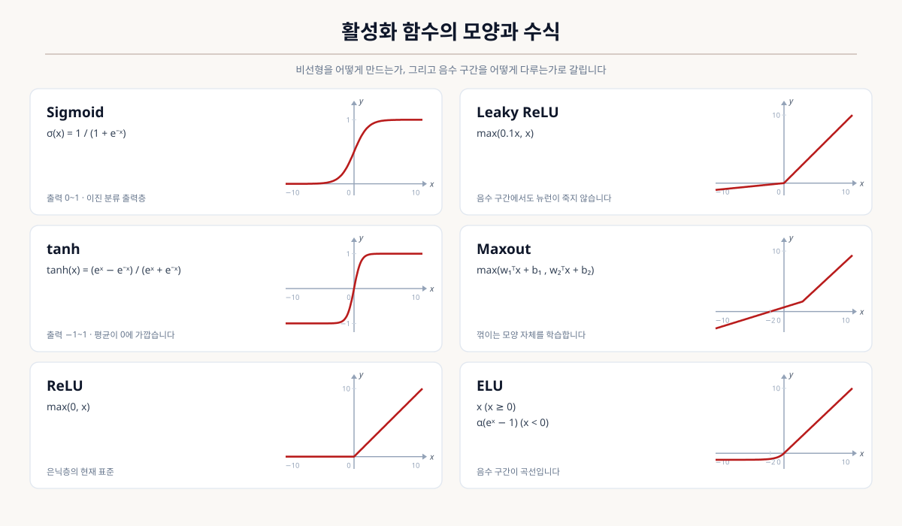

# 2-1-4. 인공신경망

> 원본: Obsidian `raw/books/05-자격증/빅데이터분석기사/pages/03-빅데이터-모델링/02-분석기법-적용/01-분석기법/04-인공신경망.md` (저작자 본인 자료). 시험 대비 문구 일부만 덜어냈습니다.

**인공신경망(Artificial Neural Network)** 은 뇌의 신경세포가 신호를 주고받는 구조를 본떠 만든 모델입니다.

다만 실제 뇌를 모방한 것은 아닙니다.
**여러 층의 단순한 계산을 쌓아 복잡한 함수를 만들어내는 구조**로 이해하는 편이 정확합니다.

## 인공신경망의 특징

| 특징 | 내용 |
| --- | --- |
| 비선형 관계 표현 | 층을 쌓아 복잡한 곡선 관계를 담아냅니다. |
| 특징의 자동 학습 | 사람이 변수를 설계하지 않아도 스스로 찾아냅니다. |
| 대규모 데이터 요구 | 학습할 값이 많아 데이터가 많이 필요합니다. |
| 높은 연산 비용 | 대량의 행렬 연산을 반복합니다. |
| 해석의 어려움 | 왜 그렇게 판단했는지 설명하기 어렵습니다. |

이 특징들은 서로 독립된 항목이 아니라 **특징 설계를 모델에 맡기기로 한 하나의 선택에서 파생된 결과**입니다.

## 인공신경망의 발전

| 시기 | 내용 |
| --- | --- |
| 퍼셉트론 | 입력에 가중치를 곱해 더한 뒤 기준을 넘으면 1을 내놓는 단순한 구조가 제안됩니다. |
| 첫 번째 침체 | 퍼셉트론이 배타적 논리합(XOR) 문제를 풀지 못한다는 한계가 드러납니다. |
| 다층 퍼셉트론과 역전파 | 은닉층을 두고 오차를 거꾸로 전파해 학습하는 방법이 나오며 한계가 풀립니다. |
| 두 번째 침체 | 층을 깊게 쌓으면 학습이 되지 않는 문제로 다시 정체됩니다. |
| 딥러닝 | 활성화 함수 개선, 사전학습, 연산 장치 발전으로 깊은 신경망 학습이 가능해집니다. |

### XOR 문제가 중요한 이유

단층 퍼셉트론은 **직선 하나로 나눌 수 있는 문제만** 풀 수 있습니다.

배타적 논리합은 두 입력이 서로 다를 때만 1이 되는 문제인데, 이 네 점은 **직선 하나로 갈라지지 않습니다.**
아무리 학습해도 풀리지 않는 문제가 존재한다는 사실이 신경망 연구를 오래 멈추게 했습니다.

해법은 **층을 하나 더 두는 것**이었습니다.
은닉층이 입력을 다른 공간으로 옮겨 놓으면, 그 공간에서는 직선으로 나눌 수 있게 됩니다.
층을 쌓는다는 것의 의미가 여기서 드러납니다.

## 인공신경망의 원리

### 구조

| 층 | 역할 |
| --- | --- |
| 입력층 | 데이터를 받습니다. 노드 수가 변수 개수와 같습니다. |
| 은닉층 | 입력을 변환합니다. 여러 층을 쌓을 수 있습니다. |
| 출력층 | 최종 결과를 내놓습니다. |

각 노드는 다음 순서로 계산합니다.

| 단계 | 내용 |
| --- | --- |
| 1 | 앞 층의 출력에 **가중치**를 곱해 모두 더합니다. |
| 2 | **편향**을 더합니다. |
| 3 | **활성화 함수**를 적용해 다음 층으로 보냅니다. |

**학습이란 가중치와 편향을 조정하는 일**입니다.
구조는 사람이 정하고, 그 안의 숫자들을 데이터가 정합니다.

### 활성화 함수

**활성화 함수가 없으면 층을 쌓는 의미가 사라집니다.**
곱하고 더하는 계산만 반복하면 아무리 겹쳐도 결국 하나의 선형식이 됩니다.
비선형 함수를 사이에 끼워야 층이 늘어난 만큼 표현력이 늘어납니다.

함수가 여럿이지만 **앞의 함수가 겪던 문제 하나를 다음 함수가 다루는** 순서로 발전했습니다.

| 함수 | 수식 | 출력 범위 | 남은 문제 |
| --- | --- | --- | --- |
| 시그모이드 | 1 / (1 + e⁻ˣ) | 0 ~ 1 | 기울기 소실 |
| 하이퍼볼릭 탄젠트 | (eˣ − e⁻ˣ) / (eˣ + e⁻ˣ) | −1 ~ 1 | 기울기 소실 |
| ReLU | max(0, x) | 0 ~ ∞ | Dying ReLU |
| Leaky ReLU | max(0.1x, x) | −∞ ~ ∞ | 음수 기울기를 사람이 정함 |
| ELU | x (x ≥ 0), α(eˣ − 1) (x < 0) | −α ~ ∞ | 지수 연산 비용 |
| Maxout | max(w₁ᵀx + b₁, w₂ᵀx + b₂) | −∞ ~ ∞ | 매개변수가 배로 늘어남 |
| 소프트맥스 | 지수화한 값을 합으로 나눔 | 합이 1 | (출력층 전용) |

#### 시그모이드

출력이 항상 0과 1 사이로 눌립니다. 확률로 읽을 수 있어 **이진 분류의 출력층**에 쓰입니다.

문제는 양 끝입니다.
입력의 절댓값이 커지면 그래프가 평평해지고, 그 구간의 기울기가 0에 가까워집니다.
**기울기 소실**의 직접적인 원인이며, 초기 신경망이 깊어지지 못한 이유가 여기에 있습니다.

#### 하이퍼볼릭 탄젠트

시그모이드와 모양은 같되 출력 범위를 −1에서 1로 넓혔습니다.

**출력의 평균이 0에 가깝다**는 점이 시그모이드와의 실질적인 차이입니다.
시그모이드는 출력이 항상 양수라 다음 층으로 넘어가는 값이 한쪽으로 치우치는데, tanh는 그 편향이 없어 학습이 더 빠릅니다.
다만 양 끝이 평평한 것은 그대로여서 기울기 소실을 완전히 해결하지는 못합니다.
순서가 있는 데이터를 다루는 RNN 계열의 은닉층에서 아직 쓰입니다.

#### ReLU

음수는 0으로, 양수는 그대로 통과시킵니다. 현재 은닉층의 표준입니다.

| 얻은 것 | 이유 |
| --- | --- |
| 기울기 소실 완화 | 양수 구간의 기울기가 **항상 1**이라 곱해도 값이 줄지 않습니다. |
| 빠른 연산 | 비교 한 번이면 끝나 지수 연산이 없습니다. |
| 희소한 활성 | 음수 입력이 0이 되어 일부 노드만 켜집니다. |

**Dying ReLU**가 대가입니다.
어떤 노드의 입력이 계속 음수이면 출력이 0이고 기울기도 0이 되어, **그 노드는 다시 학습되지 않습니다.**
학습률이 크면 한 번의 큰 갱신으로 노드가 이 상태에 빠지기도 합니다.

#### Leaky ReLU

Dying ReLU를 다루기 위해 음수 구간에 **작은 기울기**를 남겼습니다.
0 대신 0.1x를 내보내면 기울기가 0이 아니므로, 노드가 완전히 죽지 않고 소량의 신호를 계속 전달합니다.
학습이 불안정하기 쉬운 GAN 등에서 선호됩니다. 음수 쪽 기울기를 사람이 정해야 한다는 점이 남는데, 이 값을 학습으로 정하는 변형도 있습니다.

#### ELU

같은 문제를 **곡선으로** 다룹니다. 음수 구간에서 지수 함수를 써서 −α에 부드럽게 수렴합니다.

| 얻는 것 | 치르는 것 |
| --- | --- |
| 음수 출력이 있어 평균이 0에 가까워집니다. | 지수 연산이 들어가 ReLU보다 느립니다. |
| 0에서 꺾이지 않고 부드럽게 이어집니다. | α를 정해야 합니다. |

#### Maxout

여러 선형식을 두고 그중 **가장 큰 값**을 내보냅니다.
ReLU는 max(0, x)이므로 두 선형식 중 하나가 0인 특수한 경우이고, Leaky ReLU도 마찬가지입니다.
**Maxout은 두 직선의 기울기와 절편을 모두 학습**하므로, 꺾이는 모양 자체를 데이터가 정합니다.
죽는 구간이 없고 표현력이 크지만, **선형식 개수만큼 매개변수가 늘어나** 연산량이 배로 커집니다.

#### 소프트맥스

앞의 함수들과 성격이 다릅니다. 값 하나가 아니라 **여러 값을 한꺼번에** 받아 합이 1인 확률로 바꿉니다.
각 값을 지수화한 뒤 전체 합으로 나누므로, 큰 값이 더 크게 강조되면서도 합은 1로 유지됩니다.
**다중 분류의 출력층 전용**이며 은닉층에는 쓰지 않습니다.

#### 어디에 무엇을 쓰는가

| 위치 | 상황 | 함수 |
| --- | --- | --- |
| 은닉층 | 일반적인 경우 | ReLU |
| 은닉층 | Dying ReLU가 우려될 때 | Leaky ReLU, ELU |
| 은닉층 | 순서가 있는 데이터(RNN 계열) | tanh |
| 출력층 | 이진 분류 | 시그모이드 |
| 출력층 | 다중 분류 | 소프트맥스 |
| 출력층 | 회귀 | 활성화 함수를 두지 않습니다 |

회귀는 실수 전체를 내놓아야 하므로 범위를 눌러서는 안 됩니다.
활성화 함수의 역할이 비선형을 만드는 것과 **출력을 필요한 형태로 맞추는 것** 두 가지임을 보여 주는 지점입니다.

### 출력값을 직접 계산해 보기

마지막 은닉층에서 출력층으로 넘어가는 한 걸음을 계산해 보겠습니다.

| 항목 | 값 |
| --- | --- |
| 은닉층 첫 번째 노드의 출력 | 0.1 |
| 은닉층 두 번째 노드의 출력 | −0.1 |
| 첫 번째 노드의 가중치 | 2 |
| 두 번째 노드의 가중치 | 3 |
| 출력층 편향 | −0.1 |
| 출력층 활성화 함수 | f(x) = x (x ≥ 0), f(x) = −1 (x < 0) |

1. 가중치를 곱해 더합니다: 0.1 × 2 + (−0.1) × 3 = **−0.1**
2. 편향을 더합니다: −0.1 + (−0.1) = **−0.2** (가중합, 순입력)
3. 활성화 함수를 적용합니다: f(−0.2) = **−1**

| 실수 | 내용 |
| --- | --- |
| 편향을 빠뜨림 | 편향이 +0.2였다면 순입력이 0.1이 되어 출력이 0.1로 바뀝니다. |
| 활성화 함수를 건너뜀 | 순입력 −0.2를 그대로 답으로 적는 경우입니다. |
| 경계값을 반대로 읽음 | 이 함수는 `x ≥ 0`이 첫 번째 갈래이므로 순입력이 정확히 0이면 출력도 0입니다. |

## 학습

### 학습의 흐름

| 단계 | 내용 |
| --- | --- |
| 순전파 | 입력을 넣어 출력을 계산합니다. |
| 손실 계산 | 출력과 정답의 차이를 손실함수로 잽니다. |
| 역전파 | 손실을 줄이려면 각 가중치를 어느 방향으로 바꿔야 하는지 거꾸로 계산합니다. |
| 가중치 갱신 | 계산된 방향으로 가중치를 조금씩 옮깁니다. |

이 과정을 반복하며 손실이 줄어드는 방향으로 나아가는 것이 **경사하강법**입니다.

### 주요 설정값

| 설정 | 내용 | 잘못 정하면 |
| --- | --- | --- |
| 학습률 | 한 번에 얼마나 옮길지 | 크면 최저점을 지나쳐 발산하고, 작으면 너무 느립니다. |
| 에폭 | 전체 데이터를 몇 번 반복할지 | 적으면 덜 배우고, 많으면 과적합됩니다. |
| 배치 크기 | 한 번에 몇 개를 보고 갱신할지 | 작으면 불안정하고, 크면 메모리를 많이 씁니다. |

### 과대적합 방지

| 방법 | 무엇을 하는가 | 왜 효과가 있는가 |
| --- | --- | --- |
| 가중치 규제 | 손실함수에 가중치 크기에 대한 벌점을 더합니다. | 가중치가 커야 만들 수 있는 급격한 결정 경계를 못 만들게 합니다. |
| 에폭 제한(조기 종료) | 검증 손실이 오르기 시작하면 학습을 멈춥니다. | 학습을 오래 할수록 잡음까지 맞추므로, 그 전에 끊습니다. |
| 학습률 감소 | 학습이 진행될수록 학습률을 점점 줄입니다. | 큰 폭의 갱신으로 특정 표본에 과하게 끌려가는 것을 막습니다. |
| 드롭아웃 | 학습 때마다 노드 일부를 무작위로 꺼 둡니다. | 특정 노드에만 의존하지 못하게 해, 여러 모형을 평균 낸 효과를 냅니다. |
| 데이터 증강 | 회전·이동·잡음 추가로 학습 데이터를 늘립니다. | 우연한 패턴이 반복되지 않아 규칙으로 배우기 어려워집니다. |
| 배치 정규화 | 층마다 입력 분포를 정규화합니다. | 학습을 안정시키며 부수적으로 규제 효과가 있습니다. |
| 모델 단순화 | 은닉층 수와 노드 수를 줄입니다. | 표현력 자체를 낮춰 외울 여력을 없앱니다. |

방향을 거꾸로 잡으면 과대적합이 심해집니다. 은닉층·노드 수를 늘리거나 에폭을 늘리면 과대적합이 심해지고, 학습률을 높이면 안정적인 수렴을 방해합니다.

### 기울기 소실 문제

역전파는 뒤에서 앞으로 기울기를 곱해 가며 전달합니다.
시그모이드 함수의 기울기는 최대 0.25이므로, **층을 지날 때마다 값이 계속 작아집니다.**
층이 열 개면 앞쪽에는 사실상 0이 도착하고, 앞쪽 층은 학습되지 않습니다.

**ReLU가 이 문제를 완화합니다.** 양수 구간에서 기울기가 1이라 곱해도 값이 줄지 않기 때문입니다.

## 딥러닝 모델의 종류

| 모델 | 다루는 데이터 | 핵심 발상 |
| --- | --- | --- |
| CNN(합성곱 신경망) | 이미지 | 작은 필터를 이동시키며 지역적 특징을 추출합니다. |
| RNN(순환 신경망) | 순서가 있는 데이터 | 이전 시점의 상태를 다음 계산에 넘겨 순서를 기억합니다. |
| LSTM | 긴 순서 데이터 | 무엇을 기억하고 무엇을 버릴지 문을 두어 조절합니다. |
| 오토인코더 | 정답 없는 데이터 | 압축했다 복원하며 핵심 표현을 학습합니다. |
| GAN | 생성 과제 | 생성자와 판별자를 경쟁시켜 진짜 같은 데이터를 만듭니다. |

### CNN이 이미지에 적합한 이유

| 문제 | 내용 |
| --- | --- |
| 값의 폭발 | 가로세로 100픽셀 컬러 이미지만 해도 입력이 3만 개입니다. |
| 위치 정보 손실 | 펼치는 순간 옆에 있던 픽셀끼리의 관계가 사라집니다. |

CNN은 **작은 필터를 이미지 위에서 이동시키며** 계산합니다.
같은 필터를 재사용하므로 학습할 값이 크게 줄고, 인접한 픽셀을 함께 보므로 위치 관계가 유지됩니다.
또한 같은 모양이 어디에 있든 같은 필터가 반응하므로 위치가 달라져도 인식됩니다.

### RNN과 LSTM

RNN은 이전 시점의 결과를 다음 계산에 넘겨 **순서를 기억합니다.**
문장, 시계열, 음성처럼 앞뒤 순서가 의미를 갖는 데이터에 씁니다.
문제는 **긴 순서를 기억하지 못한다**는 점입니다. 시점을 거슬러 올라갈 때마다 기울기가 작아지는 기울기 소실이 여기서도 일어납니다.
LSTM은 **무엇을 기억하고 무엇을 잊을지 결정하는 문(gate)** 을 두어 이 문제를 다룹니다.

## 인공신경망의 장단점

| 장점 | 단점 |
| --- | --- |
| 복잡한 비선형 관계를 잘 담습니다. | 왜 그런 결과가 나왔는지 설명하기 어렵습니다. |
| 특징을 사람이 설계하지 않아도 됩니다. | 대량의 데이터가 필요합니다. |
| 이미지·음성·텍스트에서 성능이 뛰어납니다. | 학습에 시간과 연산 자원이 많이 듭니다. |
| 구조를 바꿔 다양한 과제에 적용됩니다. | 정할 설정값이 많고 그 조합에 성능이 민감합니다. |
| 새 데이터로 추가 학습이 가능합니다. | 과적합되기 쉬워 별도 대책이 필요합니다. |

**정형 데이터에서는 신경망이 항상 최선은 아닙니다.** 표 형태의 데이터에서는 그래디언트 부스팅 계열이 더 좋은 성능을 내는 경우가 많습니다.
