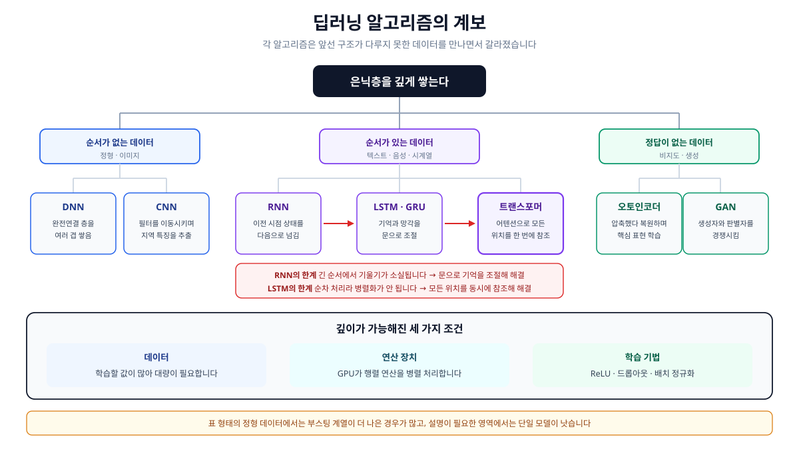

# 2-2-5. 딥러닝 분석

> 원본: Obsidian `raw/books/05-자격증/빅데이터분석기사/pages/03-빅데이터-모델링/02-분석기법-적용/02-고급-분석기법/05-딥러닝-분석.md` (저작자 본인 자료)

**딥러닝(Deep Learning)** 은 은닉층을 여러 개 쌓은 인공신경망으로 학습하는 방법입니다.

신경망의 구조와 학습 원리는 [2-1-4. 인공신경망](raw-2-1-4-neural-network.md)에서 다루었습니다.
이 절에서는 **깊게 쌓는다는 선택이 무엇을 바꾸었는지**와 알고리즘별 쓰임을 정리합니다.

## 딥러닝 분석의 개념

### 깊이가 바꾼 것

층을 늘린다는 것은 단순히 계산을 많이 한다는 뜻이 아닙니다.

| 구분 | 기존 기계학습 | 딥러닝 |
| --- | --- | --- |
| 특징 추출 | **사람이 설계**합니다. | 모델이 **데이터에서 학습**합니다. |
| 성능과 데이터량 | 일정 수준에서 완만해집니다. | 데이터가 늘수록 계속 좋아집니다. |
| 적합한 데이터 | 정형 데이터 | 이미지·음성·텍스트 등 비정형 |
| 연산 자원 | 상대적으로 적음 | GPU 등 대규모 연산 필요 |
| 해석 가능성 | 비교적 높음 | 낮음 |

첫 줄이 가장 큰 변화입니다.

고양이 사진을 분류한다고 할 때, 예전에는 사람이 귀 모양이나 털 무늬 같은 특징을 정의해 숫자로 만들어야 했습니다.
**이 작업의 품질이 성능의 상한을 결정했습니다.**

딥러닝은 이 단계를 모델 안으로 가져왔습니다.
앞쪽 층이 선과 모서리 같은 단순한 패턴을 잡고, 뒤로 갈수록 그것을 조합해 복잡한 형태를 만듭니다.
**층이 쌓이면서 표현이 점점 추상화되는 구조**가 특징 설계를 대신합니다.

### 왜 최근에야 가능해졌는가

깊은 신경망이라는 발상 자체는 오래되었습니다. 실제로 작동하게 만든 것은 세 가지가 함께 갖춰졌기 때문입니다.

| 조건 | 내용 |
| --- | --- |
| 데이터 | 학습할 값이 많아 대량의 데이터가 필요한데, 그것이 쌓였습니다. |
| 연산 장치 | GPU가 대량의 행렬 연산을 병렬로 처리하게 되었습니다. |
| 학습 기법 | ReLU, 드롭아웃, 배치 정규화 등이 깊은 층의 학습 문제를 풀었습니다. |

셋 중 하나만 빠져도 성립하지 않습니다.

### 과적합을 막는 장치

층이 깊으면 학습할 값이 많아지고, 그만큼 학습 데이터를 통째로 외워 버리기 쉽습니다.

| 기법 | 방식 |
| --- | --- |
| 드롭아웃 | 학습할 때마다 일부 노드를 **무작위로 꺼서** 특정 노드에 의존하지 않게 합니다. |
| 배치 정규화 | 층마다 입력 분포를 고르게 맞춰 학습을 안정시킵니다. |
| 조기 종료 | 검증 오차가 올라가기 시작하면 학습을 멈춥니다. |
| 데이터 증강 | 이미지를 뒤집거나 잘라 학습 데이터를 늘립니다. |
| 가중치 규제 | 가중치가 커지지 않도록 손실에 벌점을 더합니다. |

**드롭아웃이 효과적인 이유**는 앙상블과 통합니다.
노드를 매번 다르게 끄면 조금씩 다른 신경망을 여러 개 학습시키는 셈이 되고, 예측할 때는 그것들을 평균 낸 효과가 납니다.

## 딥러닝 분석 알고리즘

| 알고리즘 | 다루는 데이터 | 핵심 발상 |
| --- | --- | --- |
| DNN(심층 신경망) | 정형 데이터 | 완전연결 층을 여러 겹 쌓습니다. |
| CNN(합성곱 신경망) | 이미지, 영상 | 작은 필터를 이동시키며 지역 특징을 뽑습니다. |
| RNN(순환 신경망) | 순서가 있는 데이터 | 이전 시점의 상태를 다음 계산에 넘깁니다. |
| LSTM, GRU | 긴 순서 데이터 | 기억할 것과 버릴 것을 문으로 조절합니다. |
| 오토인코더 | 정답 없는 데이터 | 압축했다 복원하며 핵심 표현을 학습합니다. |
| GAN(생성적 적대 신경망) | 생성 과제 | 만드는 쪽과 판별하는 쪽을 경쟁시킵니다. |
| 트랜스포머 | 텍스트, 그 밖의 순서 데이터 | 어텐션으로 **모든 위치를 한 번에** 참조합니다. |

### 오토인코더

입력을 그대로 출력하도록 학습시키는 신경망입니다.

그대로 내놓는 것이 무슨 소용인가 싶지만, 가운데 층을 **입력보다 좁게** 만드는 데 요령이 있습니다.
좁은 층을 통과해야 하므로 모델은 **복원에 꼭 필요한 정보만 남기는 압축 방식**을 스스로 찾아냅니다.

| 부분 | 역할 |
| --- | --- |
| 인코더 | 입력을 저차원 표현으로 압축합니다. |
| 잠재 공간 | 압축된 표현이 놓이는 좁은 층입니다. |
| 디코더 | 압축된 표현에서 원래 입력을 복원합니다. |

정답 라벨이 필요 없어 **비지도학습**에 속합니다.

| 용도 | 방식 |
| --- | --- |
| 차원 축소 | 잠재 공간의 값을 새 변수로 씁니다. 비선형 관계까지 담는다는 점에서 주성분분석과 다릅니다. |
| 이상 탐지 | 정상 데이터로만 학습시킨 뒤 **복원이 잘 안 되는 것**을 이상으로 봅니다. |
| 잡음 제거 | 잡음을 넣은 입력에서 원본을 복원하도록 학습시킵니다. |

### GAN

두 신경망을 서로 겨루게 하는 구조입니다.

| 신경망 | 목표 |
| --- | --- |
| 생성자 | 판별자를 속일 만큼 진짜 같은 데이터를 만듭니다. |
| 판별자 | 진짜와 생성자가 만든 것을 구별합니다. |

판별자가 좋아지면 생성자는 더 정교하게 만들어야 하고, 생성자가 좋아지면 판별자는 더 세밀하게 봐야 합니다.
**경쟁이 양쪽을 함께 끌어올리는 구조**이며, 판별자가 진짜와 가짜를 구별하지 못하는 지점이 이상적인 종착점입니다.
이미지 생성, 해상도 향상, 데이터 증강에 쓰이며, 학습이 불안정하다는 어려움이 있습니다.

### 트랜스포머

RNN 계열의 두 가지 한계에서 출발했습니다.

| 한계 | 내용 |
| --- | --- |
| 순차 처리 | 앞 시점을 계산해야 다음을 계산할 수 있어 병렬화가 안 됩니다. |
| 먼 거리 의존 | 멀리 떨어진 단어 사이의 관계가 전달 과정에서 희미해집니다. |

트랜스포머는 순서대로 훑는 방식을 버리고 **모든 위치를 동시에 참조합니다.**

**어텐션**은 각 단어가 문장 안의 다른 단어들을 얼마나 참고할지 가중치로 정하는 구조입니다.
"그것"이 무엇을 가리키는지 판단할 때, 거리에 관계없이 관련 있는 단어에 큰 가중치를 줍니다.

순서 정보는 위치 정보를 따로 더해 넣는 방식으로 보존합니다.
병렬 처리가 가능해지면서 훨씬 큰 모델을 학습시킬 수 있게 되었고, 이것이 대규모 언어모델의 바탕이 되었습니다.

## 딥러닝을 쓸지 판단하기

| 딥러닝이 유리한 경우 | 다른 기법이 나은 경우 |
| --- | --- |
| 이미지·음성·텍스트 등 비정형 데이터 | 표 형태의 정형 데이터 |
| 데이터가 충분히 많음 | 데이터가 적음 |
| 사람이 특징을 정의하기 어려움 | 도메인 지식으로 특징을 잘 만들 수 있음 |
| 예측 정확도가 우선 | **판단 근거를 설명해야 함** |

정형 데이터에서는 그래디언트 부스팅 계열이 더 나은 성능을 내는 경우가 많습니다.
설명이 필요한 영역에서는 정확도가 조금 낮더라도 해석 가능한 모델을 고르는 편이 낫습니다.
